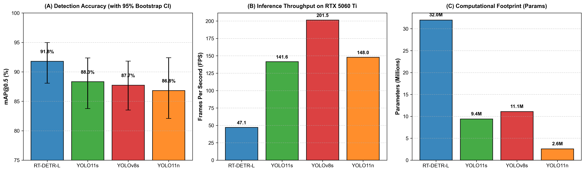
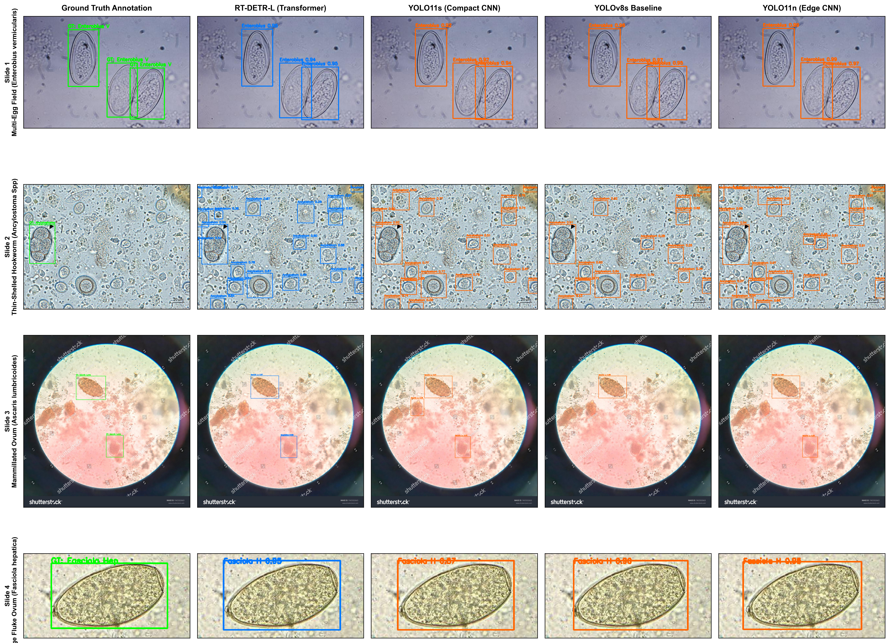
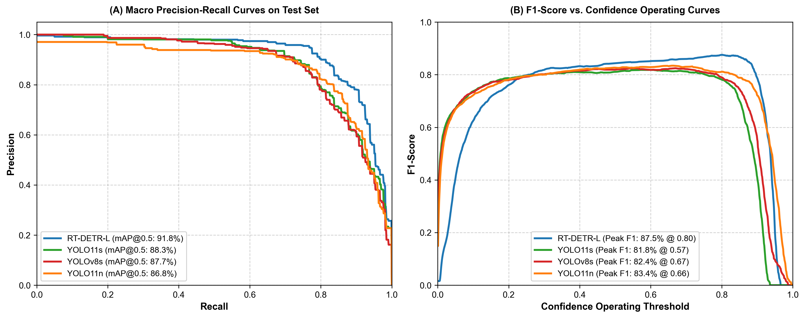
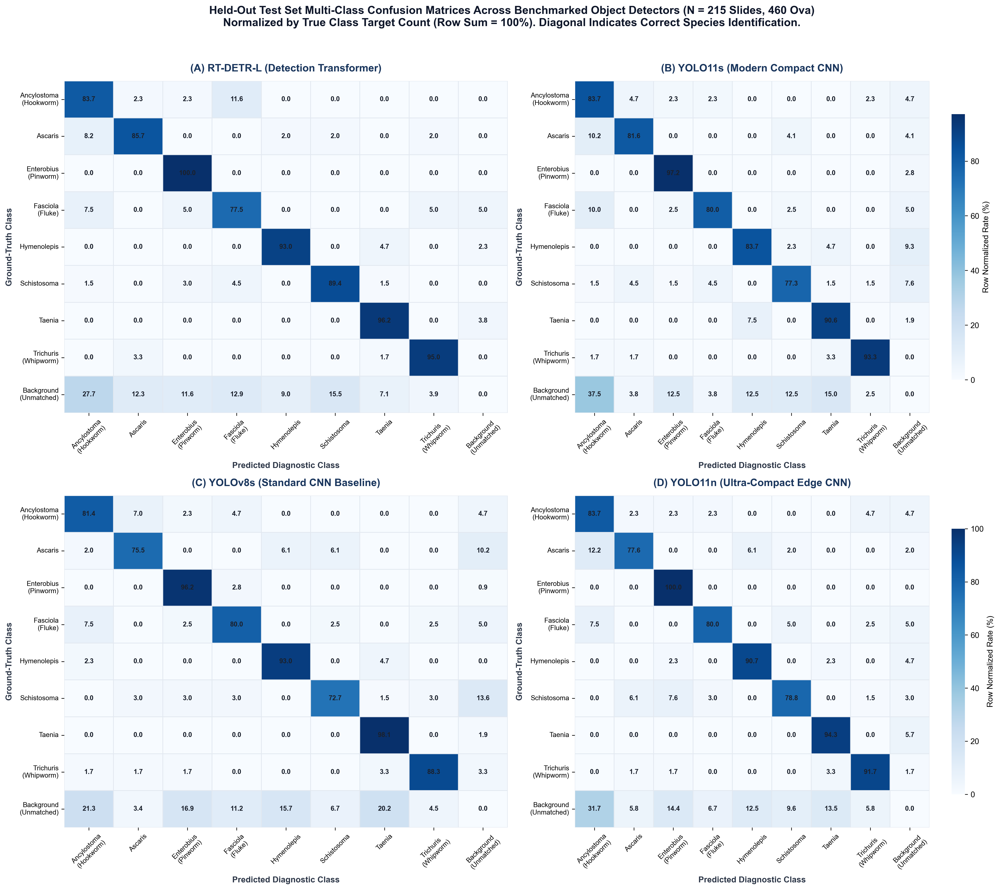
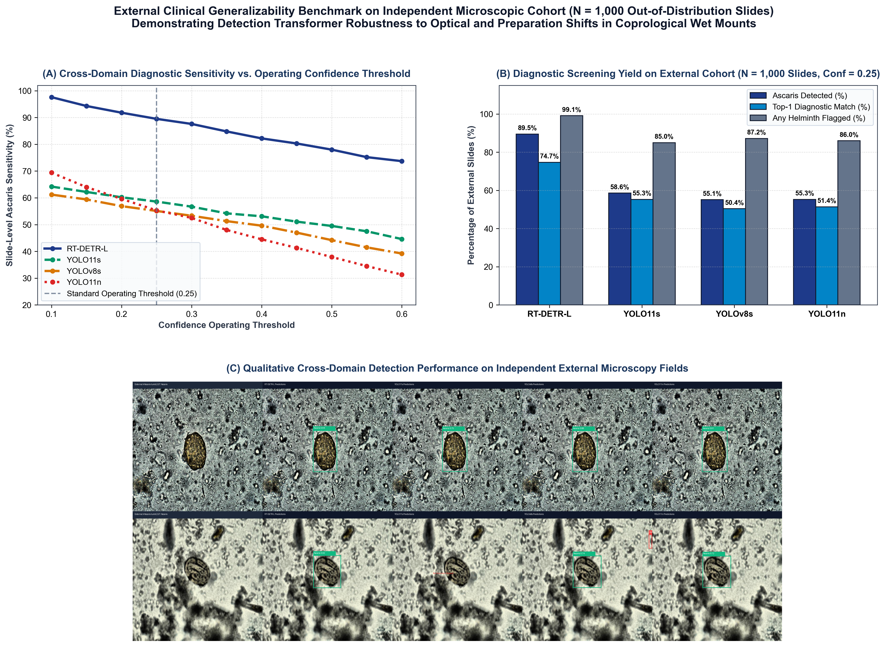

# Microscopic Parasite Detection: Benchmarking Modern Object Detection Architectures for Multi-Species Helminth Identification in Fecal Microscopy

[](https://www.python.org/downloads/)
[](https://pytorch.org/)
[](https://github.com/ultralytics/ultralytics)
[](https://creativecommons.org/licenses/by/4.0/)

Official repository for the research paper:  
**"Benchmarking Modern Object Detection Architectures for Multi-Species Helminth Parasite Identification in Fecal Microscopy"**

---

## 📌 Abstract & Overview

Manual microscopic coprological screening for soil-transmitted helminths (STHs) and intestinal parasites in fecal smears is labor-intensive and vulnerable to reader fatigue. While deep learning object detectors have shown promise, systematic benchmarks comparing transformer-based detection architectures with modern convolutional baselines on multi-species parasitic ova under standardized conditions remain scarce.

Here, we present a standardized benchmark of four object detection architectures evaluated on the 8-class **Roboflow Parasites v2** coprological microscopy dataset (2,110 brightfield images; 215 held-out test images containing 460 ground-truth ova):
- **RT-DETR-L** (Real-Time Detection Transformer)
- **YOLO11s** (Modern Compact CNN)
- **YOLOv8s** (Standard Baseline CNN)
- **YOLO11n** (Ultra-Compact Edge CNN)

All models were evaluated under identical optimizer settings, resolution ($640 \times 640$), and tested on an **NVIDIA GeForce RTX 5060 Ti GPU**.

---

## 📊 Summary Scoreboard & Benchmark Results

### Table 1: Quantitative Object Detection Benchmark (Test Set, N = 215 Images, 460 Ova)
| Model Architecture | Architectural Family | Parameters (M) | FLOPs (G) | Forward Latency (ms) | Throughput (FPS) | Precision (%) | Recall (%) | F1 (%) | mAP@0.5 (%) | Empirical 95% CI | mAP@0.5:0.95 (%) |
|:---|:---|:---:|:---:|:---:|:---:|:---:|:---:|:---:|:---:|:---:|:---:|
| **RT-DETR-L** | Detection Transformer | 32.0 | 105.4 | 21.25 (27.49) | 47.1 | **89.93** | **85.73** | **87.78** | **91.80** | [88.06, 94.96] | **77.32** |
| **YOLO11s** | Modern Compact CNN | 9.4 | 21.4 | 7.06 (8.32) | 141.6 | 85.31 | 79.17 | 82.13 | 88.33 | [83.77, 92.35] | 72.89 |
| **YOLOv8s Baseline** | Standard Baseline CNN | 11.1 | 28.4 | **4.96 (6.20)** | **201.5** | 88.61 | 77.89 | 82.90 | 87.74 | [83.52, 91.81] | 73.13 |
| **YOLO11n** | Ultra-Compact Edge CNN | **2.58** | **6.4** | 6.75 (8.95) | 148.0 | 86.86 | 81.28 | 83.98 | 86.82 | [82.08, 92.40] | 71.92 |

*Forward latency reported as median (p95). Empirical 95% confidence intervals evaluated via non-parametric image-level bootstrap ($B = 5,000$ iterations).*

---

### Table 4: Independent External Generalizability Stress Test ($N = 1,000$ Slides)
| Model Architecture | Operational Confidence Threshold | Target Pathogen (*Ascaris*) Sensitivity (%) | Top-1 Diagnostic Match Rate (%) | Any Helminth Flagged (Screening Yield) (%) | Mean Prediction Confidence |
|:---|:---:|:---:|:---:|:---:|:---:|
| **RT-DETR-L** | 0.15 | **94.30%** (943/1000) | **74.90%** | **99.40%** | 0.7501 |
| | **0.25 (Standard)** | **89.50% (895/1000)** | **74.70%** | **99.10%** | **0.7797** |
| | 0.35 | **84.80%** (848/1000) | **74.00%** | **98.20%** | **0.8059** |
| | 0.50 (Strict) | **78.00%** (780/1000) | **72.50%** | **95.70%** | **0.8396** |
| **YOLO11s** | 0.15 | 62.20% (622/1000) | 57.10% | 91.50% | 0.7001 |
| | **0.25 (Standard)** | **58.60% (586/1000)** | **55.30%** | **85.00%** | **0.7310** |
| | 0.35 | 54.20% (542/1000) | 52.80% | 78.50% | 0.7659 |
| | 0.50 (Strict) | 49.50% (495/1000) | 49.10% | 66.40% | 0.7978 |
| **YOLOv8s Baseline** | 0.15 | 59.40% (594/1000) | 51.70% | 91.40% | 0.6701 |
| | **0.25 (Standard)** | **55.10% (551/1000)** | **50.40%** | **87.20%** | **0.7073** |
| | 0.35 | 51.30% (513/1000) | 48.70% | 81.50% | 0.7376 |
| | 0.50 (Strict) | 44.20% (442/1000) | 43.30% | 68.10% | 0.7865 |
| **YOLO11n** | 0.15 | 64.00% (640/1000) | 54.90% | 94.70% | 0.5687 |
| | **0.25 (Standard)** | **55.30% (553/1000)** | **51.40%** | **86.00%** | **0.6267** |
| | 0.35 | 48.00% (480/1000) | 46.30% | 74.80% | 0.6751 |
| | 0.50 (Strict) | 37.90% (379/1000) | 37.50% | 57.70% | 0.7421 |

*Zero-shot evaluation on N = 1,000 independent out-of-distribution microscopic slides of confirmed Ascaris lumbricoides infection without domain fine-tuning.*

---

## 🖼️ Publication Figures

### Figure 1: Quantitative Benchmark Summary

*(A) mAP@0.5 with empirical 95% bootstrap confidence intervals ($B = 5,000$). (B) Inference throughput (FPS) on RTX 5060 Ti GPU. (C) Model parameter capacity.*

### Figure 2: Qualitative Detection Matrix

*Qualitative predictions across representative microscopy slides (Ground Truth vs. RT-DETR-L vs. YOLO11s vs. YOLOv8s vs. YOLO11n).*

### Figure 3: Precision-Recall & F1 Operating Curves

*(A) Macro Precision-Recall curves. (B) Macro F1-score vs. confidence threshold.*

### Figure 4: Multi-Class Confusion Matrices

*2×2 multi-class confusion matrices normalized by true class target counts across all eight helminth taxa.*

### Figure 5: Independent External Validation Benchmark (OOD N = 1,000 Slides)

*(A) Slide-level diagnostic sensitivity across operating confidence thresholds (0.10 to 0.60). (B) Diagnostic screening yield (percentage of positive slides flagged) at standard confidence = 0.25. (C) Qualitative cross-domain predictions illustrating transformer domain robustness vs. convolutional false-negative dropouts.*

---

## 🗂️ Repository Structure

```
├── MANUSCRIPT.md                   # Full research manuscript in GitHub Markdown format
├── MANUSCRIPT.docx                 # Publication-formatted Word document with embedded figures
├── MANUSCRIPT_with_figures.docx    # Archive copy of formatted Word document
├── dataset.yaml                    # YOLO dataset specification for 8-class parasite detection
├── convert_dataset.py              # Roboflow COCO to YOLO format conversion script
├── train_suite.py                  # Multi-model training and evaluation pipeline
├── run_unified_bootstrap.py        # Non-parametric bootstrap resampling (B = 5,000)
├── profile_latency.py              # Standardized GPU forward latency benchmark script
├── generate_publication_figures.py # Script generating Figures 1, 2, and 3
├── plot_confusion_matrices.py      # Script generating Figure 4 confusion matrices
├── build_manuscript_docx.py        # Programmatic Word document compiler with embedded styles
├── src/                            # Custom network architectures, evaluation, and XAI
│   ├── models/                     # Custom blocks and architectures
│   ├── evaluation/                 # Metric calculation modules
│   └── xai/                        # Explainable AI visualization hooks
└── experiments/
    ├── metrics/                    # Generated figures (300 DPI) and audited JSON metrics
    └── xai_visualizations/         # Class activation maps and feature overlay figures
```

---

## 🚀 Getting Started

### 1. Environment Setup
```bash
git clone https://github.com/Amitaddi2010/Microscopic-Parasite-Detection.git
cd Microscopic-Parasite-Detection

# Create virtual environment
python -m venv venv
source venv/bin/activate  # On Windows: .\venv\Scripts\activate

# Install dependencies
pip install torch torchvision --index-url https://download.pytorch.org/whl/cu121
pip install ultralytics python-docx matplotlib seaborn numpy pillow
```

### 2. Reproduce Benchmark Metrics & Bootstrap CIs
```bash
python run_unified_bootstrap.py
```

### 3. Generate All Publication Figures
```bash
python generate_publication_figures.py
python plot_confusion_matrices.py
```

### 4. Rebuild Formatted Word Manuscript
```bash
python build_manuscript_docx.py
```

---

## 📜 Citation

If you utilize this benchmark or codebase in your research, please cite:

```bibtex
@article{parasite_detection_benchmark_2026,
  title={Benchmarking Modern Object Detection Architectures for Multi-Species Helminth Parasite Identification in Fecal Microscopy},
  author={Anonymous Authors},
  journal={Under Review},
  year={2026}
}
```
